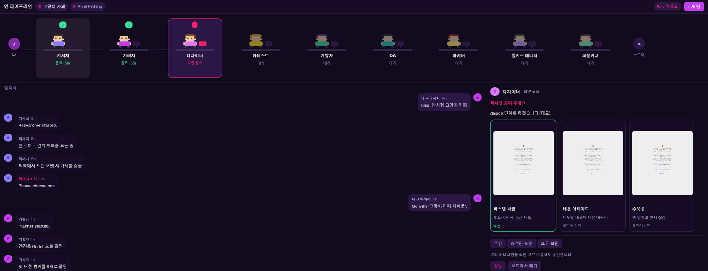
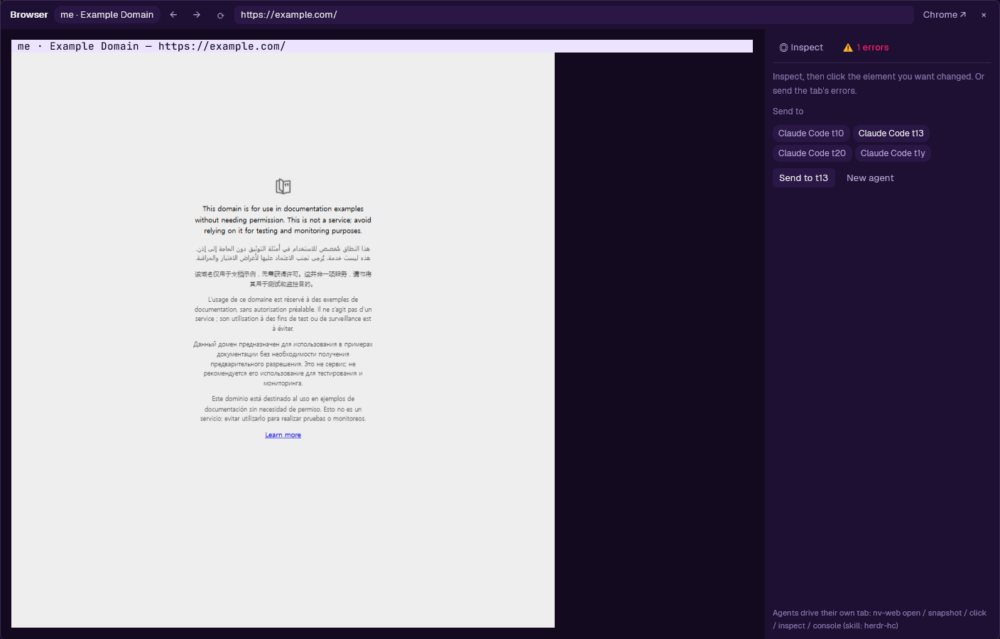
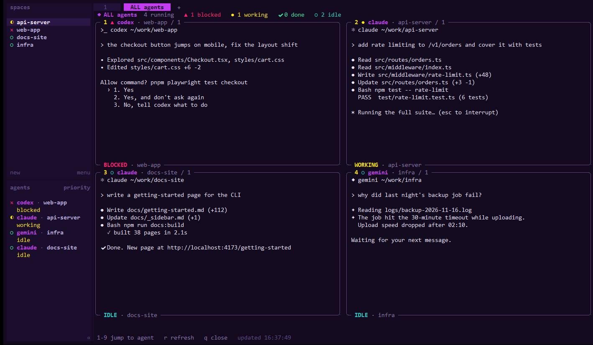
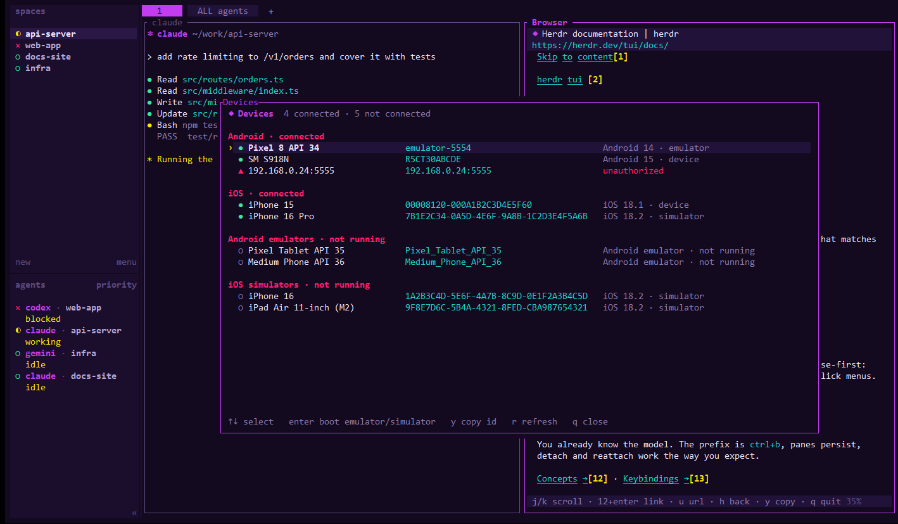

# herdr-toris-neon

[English](README.md) · [한국어](README.ko.md) · [简体中文](README.zh-CN.md) · [日本語](README.ja.md) · **Français**

Un pack d'espace de travail pour [Herdr](https://herdr.dev), l'application de bureau et le terminal pour agents de programmation. Il fait de Herdr un endroit où une équipe d'agents conçoit, construit, teste et publie une application pendant que vous regardez : un pipeline d'applications avec un tableau d'équipe en pixel art, un vrai navigateur que les agents pilotent, les pull requests, les appareils, la consommation, et un thème violet néon.



## Ce qu'il contient

| Fonction | Ouvrir | Ce qu'elle fait |
| --- | --- | --- |
| **Auto app** | menu + → Auto app · `Ctrl/Cmd+Shift+Y` | Donnez un dossier et une idée. Une équipe d'agents recherche, planifie, dessine, développe, teste sur un appareil, prépare la fiche du store et publie avec fastlane. |
| **Aujourd’hui** | menu + → Today · `Ctrl/Cmd+Shift+J` | Ce qu’il faut reprendre maintenant : un projet principal et un projet de maintenance, chacun avec la prochaine action, la raison de l’arrêt, où reprendre et si la dernière vérification tient encore. Détails : [Today](docs/TODAY.md). |
| **Navigateur avec Inspect** | `Ctrl/Cmd+Shift+U` | Un vrai Chrome/Edge dans Herdr. Les agents pilotent leurs propres onglets ; vous cliquez sur un élément, dites quoi changer et l'envoyez à un agent. |
| **ALL agents** | `Ctrl/Cmd+Shift+A` | Le terminal de chaque agent en cours sur un seul écran. Appuyez à nouveau pour revenir. |
| **Pull requests** | `Ctrl/Cmd+Shift+G` | Lire, commenter et fusionner les pull requests du dépôt à côté de votre terminal. |
| **Appareils** | `Ctrl/Cmd+Shift+D` | Appareils adb (USB et Wi-Fi), émulateurs Android et simulateurs iOS, sur cet ordinateur et ceux qui sont connectés. |
| **Fichiers, éditeur, code** | Files · `Ctrl/Cmd+Shift+H` | Une arborescence avec un éditeur, l'aperçu Markdown/HTML et la coloration syntaxique. |
| **Consommation IA** | menu + → AI usage | Jetons, coûts estimés et limites de Claude et Codex sur toutes vos machines. |
| **Coller une capture** | `Ctrl+V` · `Cmd+V` | Une capture dans le presse-papiers arrive dans Claude Code ou Codex comme image, y compris dans un terminal d'une autre machine. |
| **Mise à jour** | menu + → Update | Télécharge la dernière version depuis GitHub et l'installe, avec la progression à l'écran. |
| **Compétence pour agents** | installée pour Claude Code et Codex | `herdr-hc` apprend aux agents à orchestrer avec `hc`, à changer la fenêtre et à utiliser le navigateur. |
| **Thème violet néon** |  | Les couleurs de l'application, du herdr terminal et des schémas de terminal assortis. |

## Auto app : d'une idée au store

- Ouvrez **Auto app** dans le menu +, choisissez un dossier de projet, décrivez ce qu'il faut construire et ajoutez des références si vous en avez (liens Play Store, dépôts, captures d'écran).
- Neuf membres se relaient : chercheur, planificateur, designer, artiste, développeur, testeur, marketeur, responsable des versions, éditeur. Chacun est un nouvel agent qui lit une tâche et écrit un résultat ; rien ne s'accumule dans une conversation.
- Chaque modèle fait ce qu'il sait faire : Grok recherche, Codex dessine, Claude planifie, développe et publie. Un modèle absent ou en échec est remplacé par Claude.
- Avant le départ, choisissez pour chaque rôle un agent CLI installé sur la machine, son modèle, le nombre de travailleurs et un relecteur. Un travail refusé par la relecture ou par les contrôles automatiques des images repart pour un tour, et un test en échec revient au développeur.
- Choisissez ce qu'il vous demande : **sans surveillance**, **demander avant la production** (par défaut) ou **demander à chaque choix**. Les idées et les designs apparaissent en cartes à cliquer.
- Les applications sont faites avec Flutter ; les jeux avec Godot ou Unity + URP selon le genre. Les versions passent par la piste de test interne de Play, puis la production.
- Les références sont étudiées, jamais copiées : le genre et la boucle sont repris, le nom, les images et les textes sont nouveaux.

Détails : [Pipeline d'applications](docs/PIPELINE.md).

## Navigateur : regarder une page, montrer, faire corriger



- Sur macOS et Linux avec le runtime graphique, il utilise herdr-web-browser ; partout ailleurs, et sous Windows, il pilote votre Chrome ou Edge installé avec un profil séparé.
- Les agents utilisent `nv-web` : `open`, `snapshot`, `click`, `type`, `inspect`, `console --errors`, `network --failed`, et `css` pour essayer une correction en direct.
- **Inspect** envoie l'élément cliqué (sélecteur, styles, fichier source dans les builds de développement, capture avec contour) à l'agent de votre choix.

Détails : [Navigateur et aperçus de documents](docs/BROWSER.md).

## Agents, pull requests et appareils





## Installation

Il faut l'application de bureau Herdr (et/ou herdr terminal 0.9.5+), Node.js 22+ et Git. Le pipeline utilise les CLI d'agents que vous avez (`claude`, `codex`, `grok`) et fastlane pour les versions. Les pull requests demandent le CLI GitHub (`gh`).

**macOS / Linux**

```bash
git clone https://github.com/torisKR/herdr-toris-neon.git
cd herdr-toris-neon
./install.sh
```

**Windows (PowerShell)**

```powershell
git clone https://github.com/torisKR/herdr-toris-neon.git
cd herdr-toris-neon
.\install.ps1
```

L'installateur sauvegarde votre configuration herdr et vos raccourcis avant de les modifier, installe le thème, les dispositions, les mods et les raccourcis, et ne remplace jamais un raccourci que vous avez changé. Ensuite, **Update** dans le menu + le garde à jour.

## Plugin pour herdr terminal

Le même pack fonctionne dans herdr terminal : `prefix a` ALL agents, `prefix d` appareils, `prefix u` navigateur texte, `prefix f` fichiers et pull requests (`prefix` vaut `ctrl+b`). Faire glisser du texte dans un panneau distant le copie dans votre presse-papiers.

```bash
herdr plugin install torisKR/herdr-toris-neon/plugin
```

## Testé sur

- Windows 11 avec l'application de bureau Herdr : toutes les fonctions ci-dessus ont été exécutées dans l'application ; le pipeline a tourné de bout en bout avec un agent de remplacement, et sa première étape avec un vrai agent sur macOS.
- macOS : la première étape du pipeline, le collage de captures (en local et vers un terminal Windows) et les éléments de l'installateur ont été exécutés. Les étapes suivantes du pipeline et les envois au store n'ont pas encore été exécutés pour de vrai.

## Crédits

Les couleurs s'inspirent d'une capture du thème Cyber Purple 77 pour VS Code et ont été choisies à nouveau pour les jetons de couleur de herdr. Le navigateur graphique sur macOS/Linux est [herdr-web-browser](https://github.com/MattJColes/herdr-web-browser) (MIT).

## Licence

MIT
