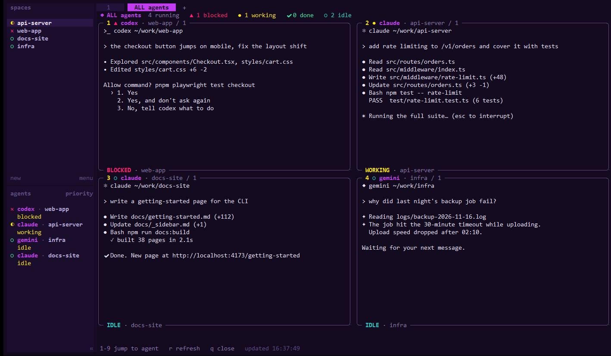
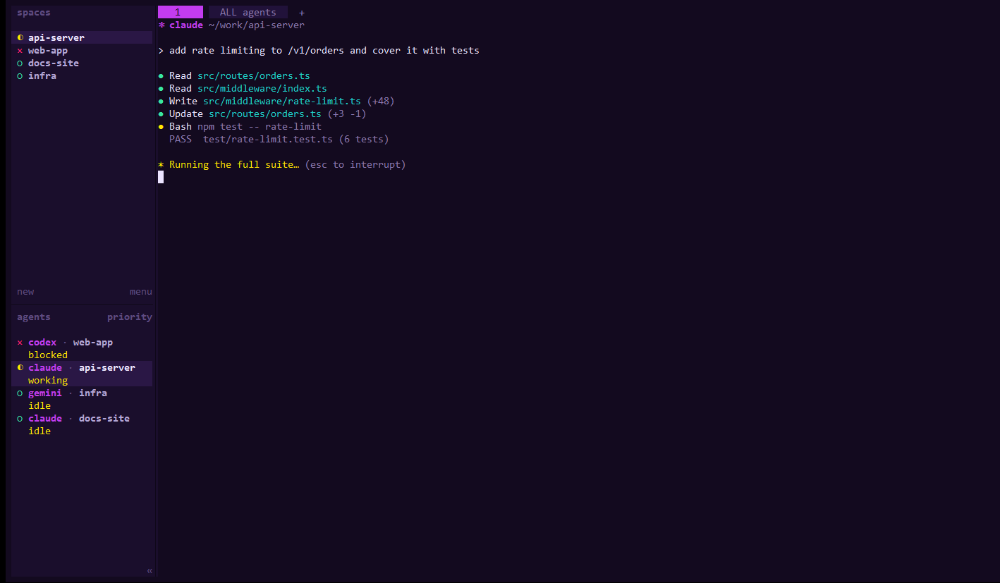
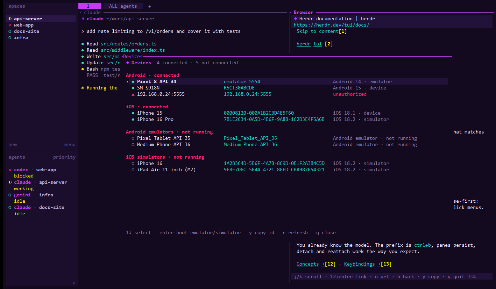
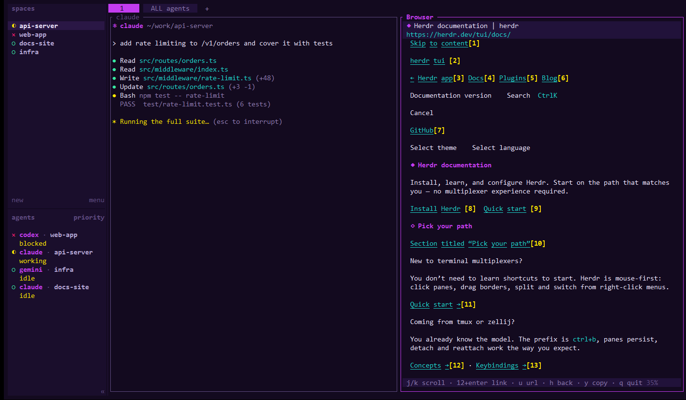

# herdr-neon-violet

[English](README.md) · [한국어](README.ko.md) · [简体中文](README.zh-CN.md) · **日本語** · [Français](README.fr.md)

[herdr](https://herdr.dev)(AI コーディングエージェント向けのターミナルワークスペース)用のネオンバイオレットのテーマとプラグイン集です。**ALL agents** ボード、**Devices** ポップアップ(adb、エミュレーター、iOS シミュレーター)、**ターミナル内ブラウザ**、SSH 越しのコピー設定、ターミナルの配色が入っています。



## 入っているもの

| 機能 | キー | 内容 |
| --- | --- | --- |
| ネオンバイオレットのテーマ | | herdr 全体の配色と、サイドバーのエージェント一覧の表示 |
| ALL agents | `prefix` `a` | 動いているエージェントをすべて 1 つのタブに並べて表示 |
| Devices | `prefix` `d` | adb デバイス、Android エミュレーター、iOS シミュレーターの一覧 |
| ブラウザ | `prefix` `u` | ターミナルの中で Web ページを読む(SSH 越しでも動作) |
| ファイルとプルリクエスト | `prefix` `f` | プレビュー付きのファイルツリーと、リポジトリのプルリクエスト(閲覧、コメント、マージ) |
| エージェントの切り替え | `prefix` `,` / `prefix` `.` | 前 / 次のエージェントへ移動 |
| SSH 越しのコピー | ドラッグ | リモートのペインで文字をドラッグすると、手元のクリップボードに入る |

`prefix` の既定値は `ctrl+b` です。

## スクリーンショット

**メイン画面。** サイドバーの下側に、エージェントが緊急度の順(ブロック中、作業中、完了、待機)で並びます。



**Devices。** 接続中のデバイスと、まだ起動していないエミュレーター・シミュレーターを表示します。`enter` で停止中のものを起動し、`y` でデバイス ID をコピーします。



**ブラウザ。** 右側の分割ペインに開き、ページを文字で表示します。リンク番号を入力して `enter` を押すと移動します。



> スクリーンショットのエージェントの会話とデバイス一覧は、`demo/` にあるサンプルデータです。

## インストール

herdr 0.9.5 以降が必要です。ツールは小さな Rust 製の実行ファイル `nv` 1 つです。Rust があればインストーラーがビルドし、なければビルド済みのものをダウンロードします。プルリクエスト機能には GitHub CLI(`gh`)が必要です。

**macOS / Linux**

```bash
git clone https://github.com/torisKR/herdr-neon-violet.git
cd herdr-neon-violet
./install.sh
```

**Windows (PowerShell)**

```powershell
git clone https://github.com/torisKR/herdr-neon-violet.git
cd herdr-neon-violet
.\install.ps1
```

インストーラーは次の 3 つを行います。

1. 現在の herdr 設定を `config.toml.bak-<日付>` にバックアップし、`config/config.toml` をインストールします。
2. `plugin/` フォルダーを herdr プラグインとしてリンクします(`herdr plugin link`)。
3. ターミナルの配色を入れます(Ghostty テーマまたは Windows Terminal の配色)。

プラグインだけ使う場合は GitHub から直接インストールし、`config/config.toml` の `[[keys.command]]` の部分を自分の設定にコピーしてください。

```bash
herdr plugin install torisKR/herdr-neon-violet/plugin
```

### ターミナルの配色を合わせる

herdr のペインの背景は、外側のターミナルの背景色をそのまま使います。スクリーンショットと同じ見た目にするには、ターミナルにも同じ配色が必要です。

| ターミナル | ファイル | 適用方法 |
| --- | --- | --- |
| Ghostty | `terminal/ghostty-neon-violet` | `~/.config/ghostty/themes/neon-violet` にコピーし、設定に `theme = neon-violet` を追加 |
| iTerm2 | `terminal/neon-violet.itermcolors` | Settings → Profiles → Colors → Color Presets → Import |
| Windows Terminal | `terminal/windows-terminal.json` | `install.ps1` が追加します。ターミナルを再起動し、プロファイルの配色で「Neon Violet」を選択 |

## Herdr デスクトップアプリ

Herdr デスクトップアプリ向けの同じ一式は `app/` にあります。`~/.config/herdr-app` フォルダーがあれば、インストーラーがそこへコピーし、すでに使っているキーは置き換えずにショートカットを `keys.json` に追加します。

| 構成 | キー | 内容 |
| --- | --- | --- |
| テーマ `neon-violet` | | アプリでも同じ配色を使います。設定で選ぶか、`herdr-app do app.theme --name neon-violet` を実行 |
| レイアウト `all-agents` | `ctrl+shift+a` | すべてのエージェントの実際のターミナルを 1 つのグリッドに表示(緊急度の高い順)。`ctrl+shift+l` でレイアウトを戻します |
| Devices | `ctrl+shift+d` | このコンピューターと、接続中のすべてのマシンのデバイス・エミュレーター・シミュレーター。停止中のものをクリックすると起動します |
| ブラウザ | `ctrl+shift+u` | 右側の分割ペインにテキストブラウザを開きます |
| レイアウト `neon-violet` | `ctrl+shift+l` | メインのレイアウトに、ウィンドウのぼかしと半透明、To-do リストを加えたもの |
| Pull requests | `ctrl+shift+g` | 今いるリポジトリのオープンなプルリクエスト(説明、変更ファイル、コメント)。パネルからコメントとマージができます |
| To-do | | エージェントに頼んだ作業を表示する、右上のフローティングリスト |

`all-agents` レイアウトでは:

- 上部のチップをクリックするか、`ctrl+d` 完了、`ctrl+w` 作業中、`ctrl+i` 待機、`ctrl+b` ブロック中、`ctrl+a` すべて、で状態ごとに絞り込みます。
- このレイアウトの表示中は、この 5 つのキーは絞り込みに使われ、ターミナル内のプログラムには届きません。
- カードのヘッダーをクリックすると、そのエージェントがメインのレイアウトで開きます。

ダークテーマです。アプリが常にライトの外観を使う設定になっている場合は、設定でダークに切り替えるとテーマが表示されます。アプリでは、文字をドラッグすると最初からコピーされ、リモートマシンのターミナルでも同じです。

## SSH 越しにドラッグでコピーする

設定で `copy_on_select = true` にしてあるので、herdr の中で文字をドラッグするとコピーされます。リモートのマシンに接続しているときに文字がどこへ入るかは、接続方法によって変わります。

- **`herdr --remote <ホスト>` または保存したマシンで接続した場合。** 画面を描く herdr が手元のコンピューターで動くので、文字はそのまま手元のクリップボードに入ります。設定は不要です。
- **`ssh` で入ってから、その中で `herdr` を実行した場合。** herdr が OSC 52 というターミナルのエスケープシーケンスで文字を送り、手元のターミナルがクリップボードに入れます。ターミナル側でこれを許可する必要があります。
  - iTerm2:Settings → General → Selection → 「Applications in terminal may access clipboard」をオン
  - Ghostty:`clipboard-write = allow`
  - macOS 標準の Terminal.app は OSC 52 に対応していません。上の `herdr --remote` の方法を使ってください。

## ALL agents

`prefix` `a` で「ALL agents」タブを開きます。すでに開いていれば、そのタブに移動します。

- エージェントごとにカードが 1 枚あり、最近の出力が 1.5 秒ごとに更新されます。
- 緊急度の順に並びます:BLOCKED、WORKING、DONE、IDLE。
- 状態で絞り込めます:`ctrl+d` 完了、`ctrl+w` 作業中、`ctrl+i` 待機、`ctrl+a` すべて。文字だけの `d`、`w`、`i`、`a` でも同じで、`b` はブロック中のエージェントを表示します。
- `1`〜`9` でそのエージェントのペインに移動し、`q` で閉じます。
- ボードに出るのは、ボードが動いている herdr サーバーのエージェントだけです。ほかのマシンのエージェントはサイドバーで確認してください。

## ファイルとプルリクエスト

`prefix` `f` で、直前にいたペインのフォルダーを起点にしたタブが開きます。マウスも使えます。行をクリックし、左右それぞれをスクロールできます。

| キー | ファイル | プルリクエスト |
| --- | --- | --- |
| `↑` `↓` / `j` `k` | 移動 | 移動 |
| `enter` またはクリック | ファイルを開く、フォルダーを展開 | プルリクエストを開く |
| `←` | 折りたたむ、または親フォルダーへ | |
| `space` / `b` | プレビューをスクロール | 内容をスクロール |
| `c` | | コメントを書く |
| `m` | | マージ。先に確認します:`y` でマージ、`s` で squash・merge・rebase を切り替え |
| `o` | | GitHub で開く |
| `y` | パスをコピー | |
| `tab` | プルリクエストへ切り替え | ファイルへ切り替え |

Herdr デスクトップアプリにはファイルエクスプローラーがすでにあるため(右上の Files ボタン)、アプリにはプルリクエストのパネルだけを追加しました。

## To-do リスト

Herdr アプリの右上に表示されるフローティングリストです。Claude Code や Codex に指示を入力するたびに項目が追加され、そのターンが終わるとチェックされて通知が出ます。自分で追加、チェック、削除もでき、接続中のすべてのマシンの項目が表示されます。

- マシンごとに 1 回有効にします:`~/.config/herdr-app/bin/nv todo hooks install`。Claude Code の `settings.json` と Codex の `hooks.json` にフックを 2 つ(指示の送信、ターンの終了)追加し、既存のフックはそのまま残してバックアップを作ります。`nv todo hooks remove` で外せます。
- `↔` と `↕` で幅と高さを変え、`–` で折りたたみ、ドラッグで移動できます。
- シェルから:`nv todo add "内容"`、`nv todo done <id>`、`nv todo list`。

## Devices

`prefix` `d` で開きます。ペインが動いているマシンで次の情報を読み取ります。

- `adb devices -l`:接続中の Android デバイスと起動中のエミュレーター(Android のバージョン付き)
- `emulator -list-avds`:まだ起動していないエミュレーター
- macOS では `xcrun simctl` と `xcrun xctrace`:iOS シミュレーターと、接続中の iPhone・iPad

`adb` と `emulator` は、`PATH`、`ANDROID_HOME`、`ANDROID_SDK_ROOT`、および Android Studio の既定の場所(`~/Library/Android/sdk` など)から探します。

## ブラウザ

`prefix` `u` で開き、アドレスか検索語を入力します。検索語は DuckDuckGo で検索します。

| キー | 動作 |
| --- | --- |
| `j` / `k`、矢印キー | スクロール |
| `space` / `b` | 1 画面下 / 上 |
| 数字 + `enter` | その番号のリンクへ移動 |
| `u` または `/` | 新しいアドレスや検索語を入力 |
| `h` | 戻る |
| `y` | 今のアドレスを手元のクリップボードにコピー |
| `o` | ペインが動いているマシンの既定のブラウザで開く |
| `q` | 閉じる |

文字だけを表示するブラウザなので、JavaScript で描画されるページは空に見えることがあります。ドキュメントを読んだり、開発サーバーの応答を確かめたりする用途に向いています。

ペインに表示された `http://localhost:<ポート>` のリンクを `ctrl`+クリックすると、このブラウザで開きます。リモートマシンの開発サーバーは、手元のノート PC の localhost ではなく、そのマシンにあるためです。それ以外のリンクは、herdr の既定どおり手元のブラウザで開きます。

## 確認した環境

- Windows 11、herdr 0.9.5、nv 0.2(Rust)で、テーマと 3 つのペイン(ALL agents、Devices、ブラウザ)を実際に動かして確認しました。
- Windows 11 の Herdr デスクトップアプリで、テーマ、`all-agents` レイアウトとその絞り込み、Devices を実際に動かして確認しました。Devices は、接続中の Mac にある実際の Android デバイス、エミュレーター、iOS シミュレーターを表示しました。
- ターミナルプラグインの Devices ペインは `demo/fixtures` のサンプル出力で確認し、同じコマンドが実際の Mac でも同じ形式を返すことを確かめました。この一式を macOS に直接インストールしての確認はまだです。問題があれば issue でお知らせください。

## クレジット

配色は VS Code のテーマ Cyber Purple 77 のスクリーンショットから着想を得て、herdr のカラートークンに合わせて選び直しました。

## ライセンス

MIT
