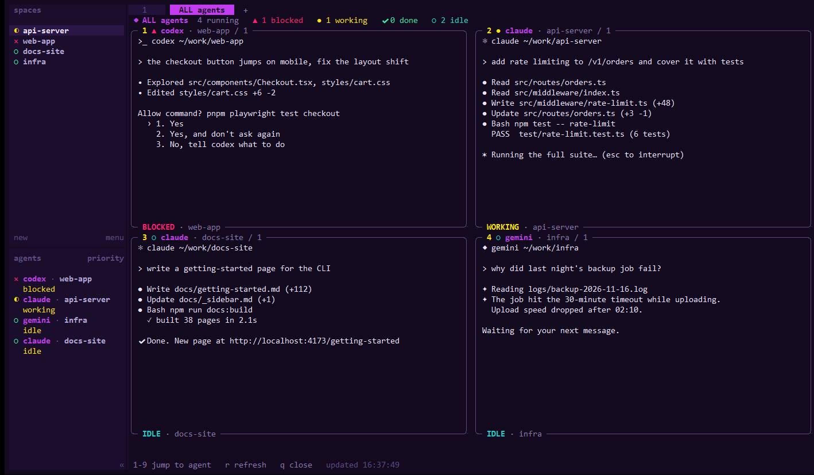
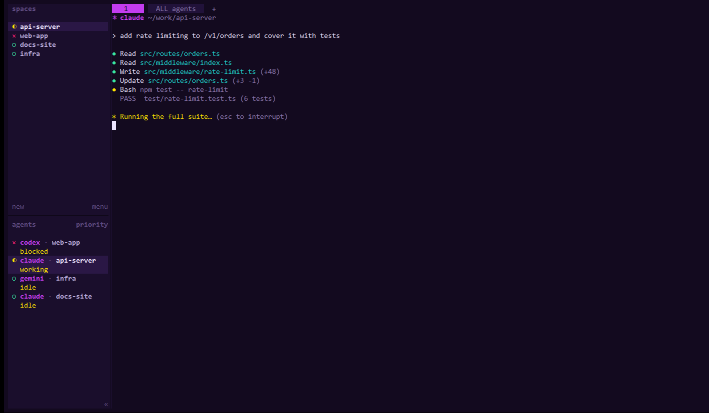
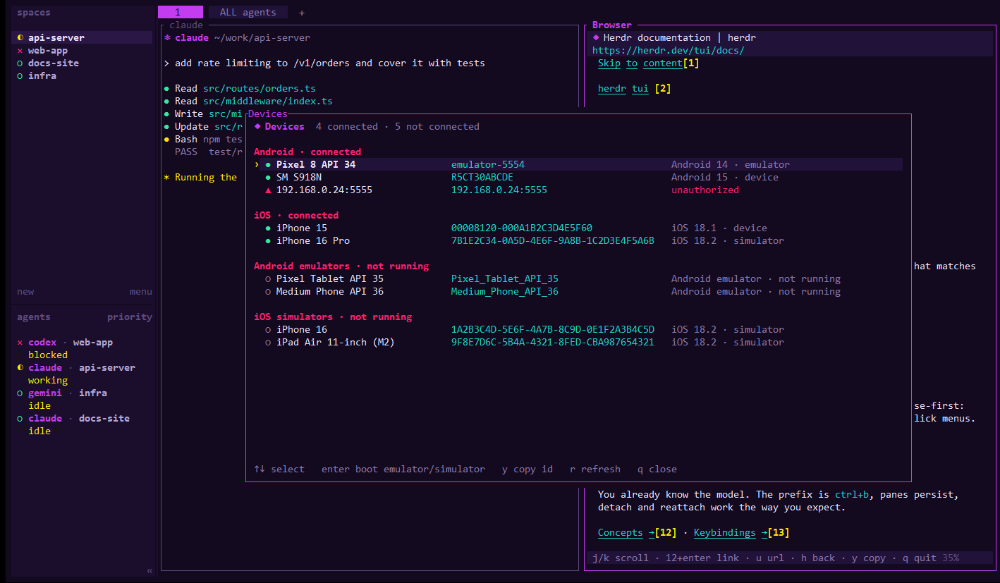
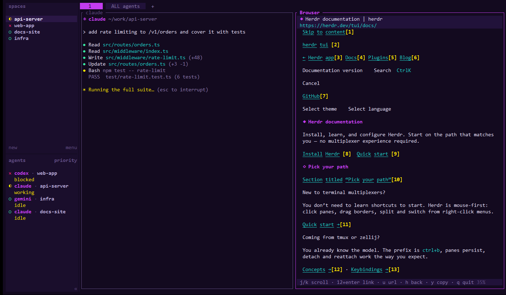

# herdr-neon-violet

[herdr](https://herdr.dev)(AI 코딩 에이전트용 터미널 작업 공간)를 위한 보라색 네온 테마와 플러그인 묶음입니다.

A neon-violet theme and plugin pack for [herdr](https://herdr.dev): an **ALL agents** board, a **Devices** popup (adb / emulators / iOS simulators), an **in-terminal browser**, clipboard-over-SSH settings, and matching terminal color schemes.



## 들어 있는 것

| 기능 | 단축키 | 설명 |
| --- | --- | --- |
| 보라색 네온 테마 | | herdr 화면 전체 색, 사이드바의 에이전트 줄 구성 |
| ALL agents | `prefix` `a` | 지금 돌고 있는 에이전트를 한 탭에 모두 타일로 표시 |
| Devices | `prefix` `d` | adb 기기, 안드로이드 에뮬레이터, iOS 시뮬레이터 목록 |
| 브라우저 | `prefix` `u` | 터미널 안에서 웹 페이지 읽기 (SSH 너머에서도 동작) |
| 에이전트 이동 | `prefix` `,` / `prefix` `.` | 이전 / 다음 에이전트로 이동 |
| SSH 너머 복사 | 드래그 | 원격 창의 글자를 드래그하면 내 컴퓨터 클립보드로 복사 |

`prefix`의 기본값은 `ctrl+b`입니다.

## 화면

**기본 화면.** 사이드바 아래쪽에 에이전트가 급한 순서(막힘 → 작업 중 → 완료 → 대기)로 나옵니다.



**Devices.** 연결된 기기와 아직 켜지 않은 에뮬레이터·시뮬레이터를 한 번에 봅니다. `enter`로 꺼져 있는 것을 켜고, `y`로 기기 ID를 복사합니다.



**브라우저.** 오른쪽에 창을 나눠 페이지를 글자로 보여 줍니다. 링크 번호를 누르고 `enter`를 치면 이동합니다.



> 캡처의 에이전트 대화와 기기 목록은 `demo/` 폴더의 예시 데이터로 만든 것입니다.

## 설치

herdr 0.9.5 이상과 Node.js 18 이상이 필요합니다.

**macOS / Linux**

```bash
git clone https://github.com/torisKR/herdr-neon-violet.git
cd herdr-neon-violet
./install.sh
```

**Windows (PowerShell)**

```powershell
git clone https://github.com/torisKR/herdr-neon-violet.git
cd herdr-neon-violet
.\install.ps1
```

설치 스크립트가 하는 일은 세 가지입니다.

1. 기존 herdr 설정을 `config.toml.bak-날짜`로 백업하고 `config/config.toml`을 설치합니다.
2. `plugin/` 폴더를 herdr 플러그인으로 연결합니다 (`herdr plugin link`).
3. 터미널 색 구성을 넣습니다 (Ghostty 테마 또는 Windows Terminal 색 구성표).

플러그인만 쓰려면 저장소를 받지 않고 바로 설치할 수 있습니다. 단축키는 `config/config.toml`의 `[[keys.command]]` 부분을 내 설정에 복사하면 됩니다.

```bash
herdr plugin install torisKR/herdr-neon-violet/plugin
```

### 터미널 색 맞추기

herdr 창 안쪽 배경은 바깥 터미널의 배경색을 그대로 씁니다. 그래서 터미널에도 같은 색을 넣어야 캡처처럼 보입니다.

| 터미널 | 파일 | 적용 방법 |
| --- | --- | --- |
| Ghostty | `terminal/ghostty-neon-violet` | `~/.config/ghostty/themes/neon-violet`로 복사하고 설정에 `theme = neon-violet` 추가 |
| iTerm2 | `terminal/neon-violet.itermcolors` | Settings → Profiles → Colors → Color Presets → Import |
| Windows Terminal | `terminal/windows-terminal.json` | `install.ps1`이 넣어 줍니다. 터미널을 다시 켠 뒤 프로필의 색 구성표에서 「Neon Violet」 선택 |

## SSH 너머에서 드래그로 복사하기

설정에 `copy_on_select = true`가 들어 있어서, herdr 안에서 글자를 드래그하면 바로 복사됩니다. 원격 컴퓨터에 접속해 있을 때 복사된 글자가 어디로 가는지는 접속 방법에 따라 다릅니다.

- **`herdr --remote <호스트>` 또는 저장한 머신으로 접속한 경우.** 화면을 그리는 herdr가 내 컴퓨터에서 돌기 때문에 내 클립보드로 바로 들어갑니다. 따로 할 일이 없습니다.
- **`ssh`로 들어간 뒤 그 안에서 `herdr`를 실행한 경우.** herdr가 OSC 52라는 터미널 신호로 글자를 내보내고, 내 터미널이 그것을 받아 클립보드에 넣습니다. 터미널이 이 신호를 허용해야 합니다.
  - iTerm2: Settings → General → Selection → "Applications in terminal may access clipboard" 켜기
  - Ghostty: `clipboard-write = allow`
  - macOS 기본 터미널(Terminal.app)은 OSC 52를 지원하지 않습니다. 이 경우 위의 `herdr --remote` 방식을 쓰세요.

## ALL agents

`prefix` `a`를 누르면 「ALL agents」 탭이 열립니다. 이미 열려 있으면 그 탭으로 이동합니다.

- 에이전트마다 카드 하나가 나오고, 최근 출력이 1.5초마다 갱신됩니다.
- 급한 순서로 정렬됩니다: 막힘(BLOCKED) → 작업 중(WORKING) → 완료(DONE) → 대기(IDLE).
- 숫자 `1`~`9`를 누르면 그 에이전트가 있는 창으로 이동합니다. `q`로 닫습니다.
- 이 보드는 보드가 열린 herdr 서버의 에이전트만 보여 줍니다. 다른 머신의 에이전트는 사이드바에서 확인하세요.

## Devices

`prefix` `d`로 엽니다. 창이 떠 있는 컴퓨터에서 다음을 읽어 옵니다.

- `adb devices -l`: 연결된 안드로이드 기기와 실행 중인 에뮬레이터 (안드로이드 버전 포함)
- `emulator -list-avds`: 아직 켜지 않은 에뮬레이터
- macOS에서는 `xcrun simctl`과 `xcrun xctrace`: iOS 시뮬레이터와 연결된 아이폰·아이패드

`adb`와 `emulator`는 `PATH`, `ANDROID_HOME`, `ANDROID_SDK_ROOT`, 그리고 Android Studio 기본 위치(`~/Library/Android/sdk` 등)에서 찾습니다.

## 브라우저

`prefix` `u`로 열고 주소나 검색어를 입력합니다. 검색어는 DuckDuckGo로 검색합니다.

| 키 | 동작 |
| --- | --- |
| `j` / `k`, 방향키 | 스크롤 |
| `space` / `b` | 한 화면 아래 / 위 |
| 숫자 + `enter` | 그 번호의 링크로 이동 |
| `u` 또는 `/` | 새 주소·검색어 입력 |
| `h` | 뒤로 |
| `y` | 지금 주소를 내 클립보드로 복사 |
| `o` | 창이 떠 있는 컴퓨터의 기본 브라우저로 열기 |
| `q` | 닫기 |

글자만 보여 주는 브라우저라서 자바스크립트로 그려지는 페이지는 내용이 비어 보일 수 있습니다. 문서 읽기나 개발 서버 응답 확인에 맞습니다.

터미널에 찍힌 `http://localhost:포트` 링크를 `ctrl`+클릭하면 이 브라우저로 열립니다. 원격 컴퓨터의 개발 서버는 내 노트북의 localhost가 아니라 그 컴퓨터에 있기 때문입니다. 그 밖의 링크는 herdr가 원래 하던 대로 내 브라우저에서 열립니다.

## 확인한 환경

- Windows 11, herdr 0.9.5, Node.js 26에서 테마와 세 창(ALL agents, Devices, 브라우저)을 실행해 확인했습니다.
- Devices의 adb·simctl 읽기는 `demo/fixtures`의 예시 출력으로만 확인했습니다. 실제 기기를 연결한 상태와 macOS에서는 아직 돌려 보지 못했습니다. 문제가 있으면 이슈로 알려 주세요.

## 만든 배경

색은 VS Code의 Cyber Purple 77 테마 화면에서 영감을 받아 herdr의 색 토큰에 맞춰 새로 골랐습니다.

## 라이선스

MIT
