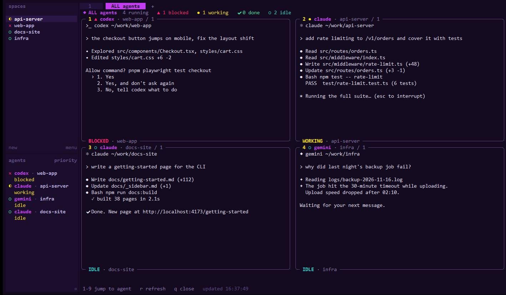
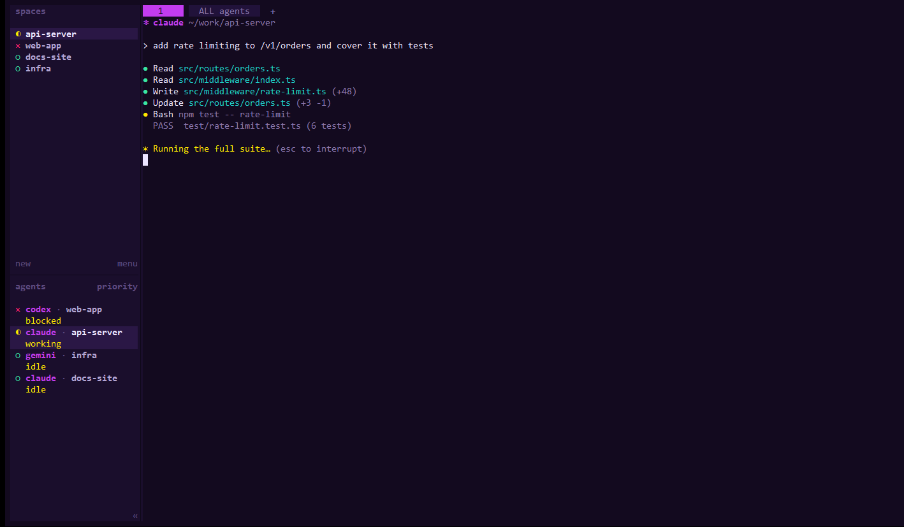
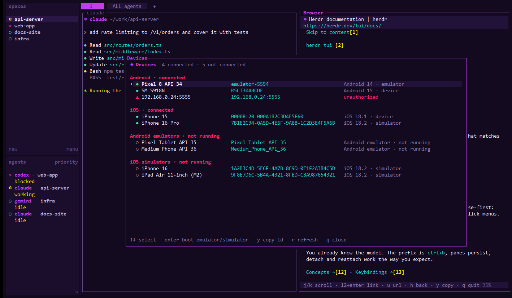
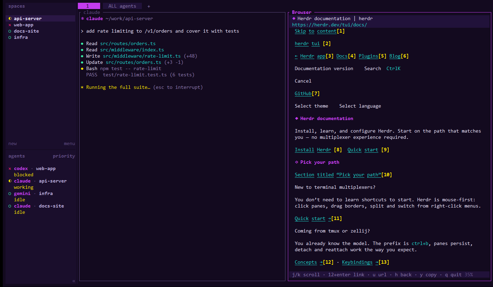

# herdr-neon-violet

**English** · [한국어](README.ko.md) · [简体中文](README.zh-CN.md) · [日本語](README.ja.md) · [Français](README.fr.md)

A neon-violet theme and plugin pack for [herdr](https://herdr.dev), the terminal workspace for AI coding agents. It adds an **ALL agents** board, a **Devices** popup (adb, emulators, iOS simulators), an **in-terminal browser**, clipboard-over-SSH settings, and matching terminal color schemes.



## What you get

| Feature | Key | What it does |
| --- | --- | --- |
| Neon violet theme | | Colors for the whole herdr UI and a richer agent list in the sidebar |
| ALL agents | `prefix` `a` | Every running agent tiled in one tab |
| Devices | `prefix` `d` | adb devices, Android emulators, and iOS simulators in one list |
| Browser | `prefix` `u` | Read web pages inside the terminal, including over SSH |
| Files and pull requests | `prefix` `f` | A file tree with a preview, and the repository's pull requests: read, comment, merge |
| Agent switching | `prefix` `,` / `prefix` `.` | Jump to the previous / next agent |
| Copy over SSH | drag | Drag text in a remote pane and it lands on your own clipboard |

`prefix` is `ctrl+b` by default.

## Screenshots

**Main view.** The lower sidebar lists agents by urgency: blocked, working, done, idle.



**Devices.** Connected devices plus the emulators and simulators that are not running yet. Press `enter` to boot a stopped one and `y` to copy a device ID.



**Browser.** Opens in a split on the right and renders the page as text. Type a link number and press `enter` to follow it.



> The agent transcripts and the device list in these screenshots come from sample data in `demo/`.

## Install

Requires herdr 0.9.5 or later. The tools are one small Rust binary, `nv`: the installer builds it when Rust is installed and downloads a prebuilt one otherwise. Pull requests need the GitHub CLI (`gh`).

**macOS / Linux**

```bash
git clone https://github.com/torisKR/herdr-neon-violet.git
cd herdr-neon-violet
./install.sh
```

**Windows (PowerShell)**

```powershell
git clone https://github.com/torisKR/herdr-neon-violet.git
cd herdr-neon-violet
.\install.ps1
```

The installer does three things:

1. Backs up your current herdr config to `config.toml.bak-<date>` and installs `config/config.toml`.
2. Links the `plugin/` folder as a herdr plugin (`herdr plugin link`).
3. Installs a terminal color scheme (Ghostty theme or Windows Terminal scheme).

To use only the plugin, install it straight from GitHub and copy the `[[keys.command]]` blocks from `config/config.toml` into your own config:

```bash
herdr plugin install torisKR/herdr-neon-violet/plugin
```

### Match your terminal colors

herdr panes use the background color of the terminal that hosts them, so the terminal needs the same colors to look like the screenshots.

| Terminal | File | How to apply |
| --- | --- | --- |
| Ghostty | `terminal/ghostty-neon-violet` | Copy to `~/.config/ghostty/themes/neon-violet` and add `theme = neon-violet` to your config |
| iTerm2 | `terminal/neon-violet.itermcolors` | Settings → Profiles → Colors → Color Presets → Import |
| Windows Terminal | `terminal/windows-terminal.json` | `install.ps1` adds it. Restart the terminal and pick "Neon Violet" as the profile's color scheme |

## Herdr desktop app

The same pack for the Herdr desktop app is in `app/`. The installers copy it into `~/.config/herdr-app` when that folder exists, and add the shortcuts to `keys.json` without replacing keys you already use.

| Piece | Key | What it does |
| --- | --- | --- |
| Theme `neon-violet` | | The same colors for the app. Pick it in Settings, or run `herdr-app do app.theme --name neon-violet` |
| Layout `all-agents` | `ctrl+shift+a` | Every agent's live terminal in one grid, most urgent first. `ctrl+shift+l` switches layouts back |
| Devices | `ctrl+shift+d` | Devices, emulators and simulators of this computer and of every connected machine. Click a stopped one to boot it |
| Browser | `ctrl+shift+u` | Opens the text browser in a split on the right |
| Layout `neon-violet` | `ctrl+shift+l` | The main layout with a blurred, translucent window and the to-do list |
| Pull requests | `ctrl+shift+g` | Open pull requests of the repository you are in: description, changed files, comments. Comment and merge from the panel |
| To-do | | A floating list at the top right of what you asked your agents to do |

In the `neon-violet` layout the `+` button at the top right also lists these tools (ALL agents, Devices, Pull requests, Browser), and a file clicked in the Files panel opens in the main area as an editor tab: syntax highlighting, line numbers, folding, editing with `ctrl+s` to save, and a rendered preview for Markdown. Files on another machine open read-only. Mermaid diagrams are shown as source, not drawn.

On macOS every shortcut of this pack uses `cmd` where this page says `ctrl`. Where `cmd+shift+d` is already taken (it splits the pane), Devices is on `cmd+shift+m`.

In the `all-agents` layout:

- Filter by state with the chips at the top or with `ctrl+d` done, `ctrl+w` working, `ctrl+i` idle, `ctrl+b` blocked, `ctrl+a` all.
- While this layout is on screen those five keys belong to the filter and do not reach the program in the terminal.
- Click a card's header to open that agent, or “Back to Herdr” to leave the board. When opened from the `+` menu, both return to the layout you came from, keeping its menu tools and To-do list. Direct entry defaults to Neon Violet when installed.

The theme is dark. If the app is set to always use the light appearance, switch it to dark in Settings for the theme to show. Dragging over text already copies in the app, on remote machines too.

## Copying over SSH by dragging

The config sets `copy_on_select = true`, so dragging over text in herdr copies it. Where the text ends up when you are on a remote machine depends on how you connected.

- **Connected with `herdr --remote <host>` or a saved machine.** The herdr that draws the screen runs on your own computer, so the text goes straight to your clipboard. Nothing to set up.
- **Connected with `ssh`, then ran `herdr` inside it.** herdr sends the text with a terminal escape sequence called OSC 52, and your terminal puts it on the clipboard. The terminal has to allow that.
  - iTerm2: Settings → General → Selection → turn on "Applications in terminal may access clipboard"
  - Ghostty: `clipboard-write = allow`
  - The built-in macOS Terminal.app does not support OSC 52. Use the `herdr --remote` route above.

## ALL agents

`prefix` `a` opens the "ALL agents" tab, or switches to it if it is already open.

- One card per agent, with its recent output refreshed every 1.5 seconds.
- Sorted by urgency: BLOCKED, WORKING, DONE, IDLE.
- Filter by state: `ctrl+d` done, `ctrl+w` working, `ctrl+i` idle, `ctrl+a` all. The plain letters `d`, `w`, `i`, `a` work too, and `b` shows blocked agents.
- Press `1`–`9` to jump to that agent's pane. Press `q` to close.
- The board shows the agents of the herdr server it runs on. Agents on other machines appear in the sidebar.

## Files and pull requests

`prefix` `f` opens a tab rooted at the folder of the pane you were in. The mouse works: click a row, scroll either side.

| Key | Files | Pull requests |
| --- | --- | --- |
| `↑` `↓` / `j` `k` | Move | Move |
| `enter` or click | Open a file, expand a folder | Open the pull request |
| `←` | Collapse, or go to the parent folder | |
| `space` / `b` | Scroll the preview | Scroll the pull request |
| `c` | | Write a comment |
| `m` | | Merge. It asks first: `y` merges, `s` switches between squash, merge and rebase |
| `o` | | Open on GitHub |
| `y` | Copy the path | |
| `tab` | Switch to pull requests | Switch to files |

The Herdr desktop app already has a file explorer (the Files button at the top right), so this pack adds only the pull request panel there.

## To-do list

The Herdr app shows a floating list at the top right. Each instruction you give Claude Code or Codex becomes an item, and the item is checked when that turn ends, with a notification. You can add, check and remove items yourself, and the list includes every connected machine.

- Turn it on for your agents once per machine: `~/.config/herdr-app/bin/nv todo hooks install`. It adds two hooks (prompt submitted, turn ended) to Claude Code's `settings.json` and Codex's `hooks.json`, keeps the hooks you already have, and writes a backup. `nv todo hooks remove` takes them out.
- `↔` and `↕` change the width and height, `–` folds it, and you can drag it anywhere.
- From a shell: `nv todo add "text"`, `nv todo done <id>`, `nv todo list`.
- The `文` button selects Korean, English, Japanese or Simplified Chinese and remembers your choice. “Follow Herdr” (the default) follows Herdr's `language` or `locale` setting, with English as the fallback when none is available or supported.

Each row shows a short headline, and clicking it opens the details: the whole instruction, where it runs, when it started and finished, and a button that takes you to the agent. The headline appears at once from simple rules and is replaced a few seconds later by one written by a small model (Claude Haiku, a separate headless call that uses a few hundred tokens per instruction and adds nothing to the agent's own conversation). Set `NV_TODO_NO_SUMMARY=1` to keep the rule-based headlines and spend no tokens.

## Devices

`prefix` `d` opens it. It reads the following on the machine where the pane runs:

- `adb devices -l`: connected Android devices and running emulators, with the Android version
- `emulator -list-avds`: emulators that are not running yet
- On macOS, `xcrun simctl` and `xcrun xctrace`: iOS simulators and connected iPhones and iPads

`adb` and `emulator` are looked up on `PATH`, in `ANDROID_HOME` and `ANDROID_SDK_ROOT`, and in the default Android Studio locations such as `~/Library/Android/sdk`.

## Browser

`prefix` `u` opens it. Type an address or a search query. Queries go to DuckDuckGo.

| Key | Action |
| --- | --- |
| `j` / `k`, arrow keys | Scroll |
| `space` / `b` | Page down / up |
| number + `enter` | Follow the link with that number |
| `u` or `/` | Enter a new address or query |
| `h` | Back |
| `y` | Copy the current address to your clipboard |
| `o` | Open in the default browser of the machine the pane runs on |
| `q` | Close |

This is a text browser, so pages drawn by JavaScript can look empty. It suits reading docs and checking what a dev server returns.

`ctrl`+click on a `http://localhost:<port>` link in a pane opens it in this browser. A dev server on a remote machine lives on that machine, not on your laptop's localhost. Other links open in your own browser, as herdr does by default.

## Tested on

- Windows 11, herdr 0.9.5, nv 0.2 (Rust): the theme and the three panes (ALL agents, Devices, Browser) were run and checked.
- Herdr desktop app on Windows 11: the theme, the `all-agents` layout with its filters, and Devices were run in the app. Devices listed real Android devices, emulators and iOS simulators from a connected Mac.
- The terminal plugin's Devices pane was checked against the sample output in `demo/fixtures`; the same commands return that format on a real Mac. The pack has not been installed on macOS itself yet. Please open an issue if something is off.

## Credits

The colors were inspired by a screenshot of the Cyber Purple 77 theme for VS Code and picked anew for herdr's color tokens.

## License

MIT
