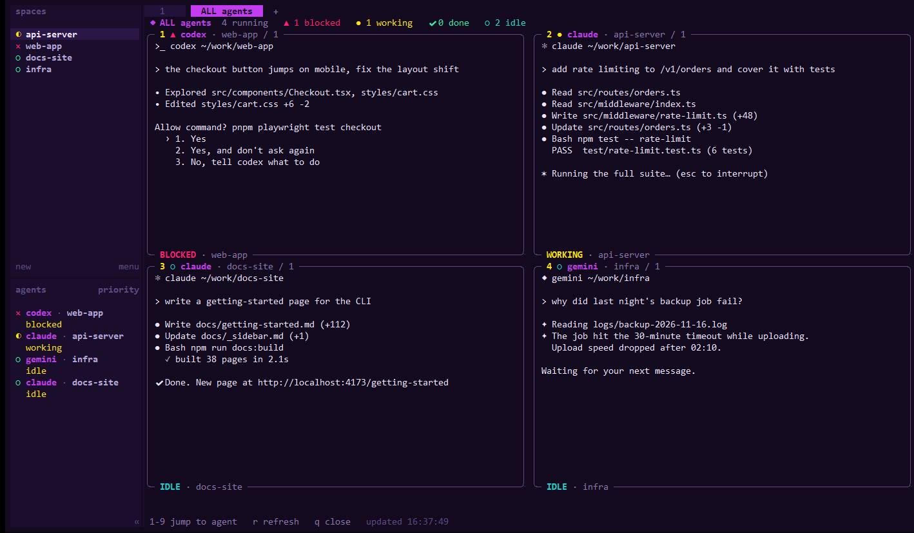
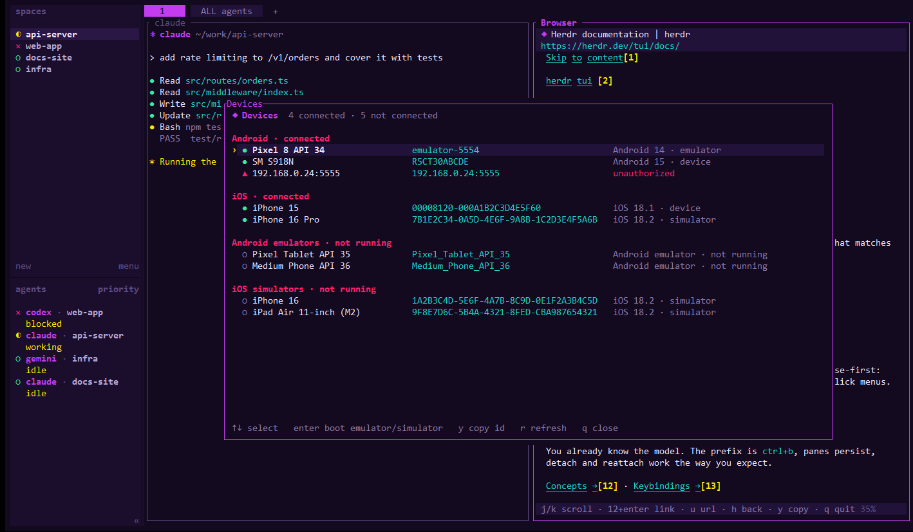
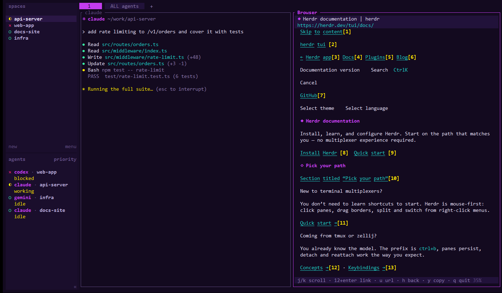

# herdr-neon-violet

[English](README.md) · [한국어](README.ko.md) · **简体中文** · [日本語](README.ja.md) · [Français](README.fr.md)

为 [herdr](https://herdr.dev)(面向 AI 编程代理的终端工作区)准备的霓虹紫主题和插件包。包含 **ALL agents** 面板、**Devices** 弹窗(adb、模拟器、iOS 模拟器)、**终端内浏览器**、通过 SSH 复制的设置,以及配套的终端配色。



## 包含的内容

| 功能 | 快捷键 | 说明 |
| --- | --- | --- |
| 霓虹紫主题 | | 整个 herdr 界面的配色,以及侧边栏里更详细的代理列表 |
| ALL agents | `prefix` `a` | 把所有正在运行的代理平铺在一个标签页里 |
| Devices | `prefix` `d` | 在一个列表里查看 adb 设备、Android 模拟器和 iOS 模拟器 |
| 浏览器 | `prefix` `u` | 在终端里阅读网页,通过 SSH 也能用 |
| 文件和拉取请求 | `prefix` `f` | 带预览的文件树,以及仓库的拉取请求:阅读、评论、合并 |
| 切换代理 | `prefix` `,` / `prefix` `.` | 跳到上一个 / 下一个代理 |
| 通过 SSH 复制 | 拖动 | 在远程窗格里拖选文字,文字会进入你本机的剪贴板 |

`prefix` 默认是 `ctrl+b`。

## 截图

**主界面。** 侧边栏下方按紧急程度列出代理:受阻、工作中、已完成、空闲。


**Devices。** 已连接的设备,以及尚未启动的模拟器。按 `enter` 启动已停止的模拟器,按 `y` 复制设备 ID。



**浏览器。** 在右侧分屏打开,以文字形式显示页面。输入链接编号再按 `enter` 即可跳转。



> 截图中的代理对话和设备列表来自 `demo/` 目录里的示例数据。

## 安装

需要 herdr 0.9.5 或更高版本。所有工具是一个小的 Rust 可执行文件 `nv`:安装脚本在装有 Rust 时自行编译,否则下载预编译版本。拉取请求功能需要 GitHub CLI(`gh`)。

**macOS / Linux**

```bash
git clone https://github.com/torisKR/herdr-neon-violet.git
cd herdr-neon-violet
./install.sh
```

**Windows (PowerShell)**

```powershell
git clone https://github.com/torisKR/herdr-neon-violet.git
cd herdr-neon-violet
.\install.ps1
```

安装脚本做三件事:

1. 把现有的 herdr 配置备份为 `config.toml.bak-<日期>`,然后安装 `config/config.toml`。
2. 把 `plugin/` 目录链接为 herdr 插件(`herdr plugin link`)。
3. 安装终端配色(Ghostty 主题或 Windows Terminal 配色方案)。

如果只想用插件,可以直接从 GitHub 安装,再把 `config/config.toml` 里的 `[[keys.command]]` 部分复制到自己的配置中:

```bash
herdr plugin install torisKR/herdr-neon-violet/plugin
```

### 让终端配色保持一致

herdr 窗格的背景使用外层终端的背景色,所以终端也要用同样的颜色,效果才会和截图一致。

| 终端 | 文件 | 应用方法 |
| --- | --- | --- |
| Ghostty | `terminal/ghostty-neon-violet` | 复制到 `~/.config/ghostty/themes/neon-violet`,并在配置里加上 `theme = neon-violet` |
| iTerm2 | `terminal/neon-violet.itermcolors` | Settings → Profiles → Colors → Color Presets → Import |
| Windows Terminal | `terminal/windows-terminal.json` | 由 `install.ps1` 添加。重启终端后,在配置文件的配色方案里选择 "Neon Violet" |

## Herdr 桌面应用

面向 Herdr 桌面应用的同一套内容放在 `app/` 目录里。如果存在 `~/.config/herdr-app` 目录,安装脚本会把它复制进去,并把快捷键加入 `keys.json`,不会替换你已经在用的按键。

| 组成 | 快捷键 | 说明 |
| --- | --- | --- |
| 主题 `neon-violet` | | 应用也使用同样的配色。在设置里选择,或运行 `herdr-app do app.theme --name neon-violet` |
| 布局 `all-agents` | `ctrl+shift+a` | 把所有代理的实时终端排成一个网格,最紧急的在前。`ctrl+shift+l` 切换回其他布局 |
| Devices | `ctrl+shift+d` | 本机以及所有已连接机器上的设备和模拟器。点击已停止的模拟器即可启动 |
| 浏览器 | `ctrl+shift+u` | 在右侧分屏打开文字浏览器 |
| 布局 `neon-violet` | `ctrl+shift+l` | 在主布局上加入窗口模糊、半透明和待办列表 |
| Pull requests | `ctrl+shift+g` | 当前仓库的未合并拉取请求:说明、改动文件、评论。可在面板里评论和合并 |
| To-do | | 悬浮在右上角的列表,显示你交给代理的任务 |

在 `neon-violet` 布局中,右上角的 `+` 按钮也会列出这些工具(ALL agents、Devices、Pull requests、Browser)。在 Files 面板里点击文件,会在主区域以编辑器标签页打开:语法高亮、行号、折叠、可编辑并用 `ctrl+s` 保存,Markdown 可渲染预览。其他机器上的文件以只读方式打开。Mermaid 图表显示为源码,不会绘制。

在 macOS 上,这套内容的所有快捷键都用 `cmd` 代替 `ctrl`。如果 `cmd+shift+d` 已被占用(用于拆分窗格),Devices 使用 `cmd+shift+m`。

在 `all-agents` 布局中:

- 点击顶部的筛选按钮,或用 `ctrl+d` 已完成、`ctrl+w` 工作中、`ctrl+i` 空闲、`ctrl+b` 受阻、`ctrl+a` 全部,按状态筛选。
- 这个布局显示时,这五个按键归筛选使用,不会传给终端里的程序。
- 点击卡片标题栏可打开对应代理,点击“Back to Herdr”可离开面板。从 `+` 菜单进入时,两者都会返回原来的布局,保留菜单工具和待办列表。直接进入时,若已安装 Neon Violet,则返回该布局。

这是深色主题。如果应用被设置为始终使用浅色外观,需要在设置里改成深色,主题才会显示。在应用里拖选文字本来就会复制,远程机器上的终端也一样。

## 通过 SSH 拖动复制

配置里设置了 `copy_on_select = true`,所以在 herdr 里拖选文字就会复制。连接到远程机器时,文字会去哪里取决于连接方式。

- **用 `herdr --remote <主机>` 或已保存的机器连接。** 负责绘制界面的 herdr 运行在你自己的电脑上,文字会直接进入你的剪贴板,不需要额外设置。
- **先用 `ssh` 登录,再在里面运行 `herdr`。** herdr 通过名为 OSC 52 的终端转义序列发送文字,由你的终端写入剪贴板。终端必须允许这个操作。
  - iTerm2:Settings → General → Selection → 打开 "Applications in terminal may access clipboard"
  - Ghostty:`clipboard-write = allow`
  - macOS 自带的 Terminal.app 不支持 OSC 52,请改用上面的 `herdr --remote` 方式。

## ALL agents

`prefix` `a` 打开 "ALL agents" 标签页;如果已经打开,就切换过去。

- 每个代理一张卡片,最近的输出每 1.5 秒刷新一次。
- 按紧急程度排序:BLOCKED、WORKING、DONE、IDLE。
- 按状态筛选:`ctrl+d` 已完成、`ctrl+w` 工作中、`ctrl+i` 空闲、`ctrl+a` 全部。单独按字母 `d`、`w`、`i`、`a` 也可以,`b` 显示受阻的代理。
- 按 `1`–`9` 跳到对应代理的窗格,按 `q` 关闭。
- 面板只显示它所在的 herdr 服务器上的代理。其他机器上的代理请在侧边栏查看。

## 文件和拉取请求

`prefix` `f` 会打开一个标签页,以你刚才所在窗格的目录为根。支持鼠标:点击某一行,两侧可分别滚动。

| 按键 | 文件 | 拉取请求 |
| --- | --- | --- |
| `↑` `↓` / `j` `k` | 移动 | 移动 |
| `enter` 或点击 | 打开文件、展开目录 | 打开拉取请求 |
| `←` | 折叠,或回到上级目录 | |
| `space` / `b` | 滚动预览 | 滚动内容 |
| `c` | | 写评论 |
| `m` | | 合并。会先询问:`y` 合并,`s` 在 squash、merge、rebase 之间切换 |
| `o` | | 在 GitHub 上打开 |
| `y` | 复制路径 | |
| `tab` | 切换到拉取请求 | 切换到文件 |

Herdr 桌面应用本身已有文件浏览器(右上角的 Files 按钮),所以这里只为应用增加了拉取请求面板。

## 待办列表

Herdr 应用右上角有一个悬浮列表。你每次给 Claude Code 或 Codex 下达指令都会生成一项,该轮结束时会被勾选并弹出通知。你也可以自己添加、勾选和删除,列表会包含所有已连接机器上的项目。

- 每台机器开启一次:`~/.config/herdr-app/bin/nv todo hooks install`。它会在 Claude Code 的 `settings.json` 和 Codex 的 `hooks.json` 中加入两个钩子(提交指令、该轮结束),保留已有的钩子并写入备份。用 `nv todo hooks remove` 移除。
- `↔` 和 `↕` 调整宽度和高度,`–` 折叠,也可以拖到任意位置。
- 在命令行中:`nv todo add "内容"`、`nv todo done <id>`、`nv todo list`。
- 点击 `文` 按钮可选择韩语、英语、日语或简体中文,并记住选择。默认的“跟随 Herdr 设置”使用 Herdr 的 `language` 或 `locale` 设置;没有语言设置或语言不受支持时使用英语。
- 智能体生成的标题会使用所选语言,不受原始指令语言影响。已有标题也会分批翻译并按语言缓存。手动输入的事项和详情中的原始指令保持不变。使用现有的 Claude Haiku CLI;`NV_TODO_NO_SUMMARY=1` 也会禁用翻译。翻译连接机器上的标题前,请更新该机器的 `nv`。
- 在列表内滚动,或用 `↑`、`↓` 跳到第一项、最后一项。行高保持不变,自动刷新会保留滚动位置。
- 优先级为 `P0` 紧急、`P1` 高、`P2` 普通、`P3` 低。自动模式根据指令中的关键词分类,无需调用模型。未完成事项按优先级排序,强调紧急和高优先级,已完成事项放在下方。点击徽章切换,或在详情中选择级别、恢复自动。命令行使用 `nv todo priority <id> high` 或 `nv todo priority <id> auto`。修改连接机器上的优先级前,请更新该机器的 `nv`。

每一行显示一个简短标题,点击后展开详情:完整指令、运行位置、开始和完成时间,以及跳转到对应代理的按钮。标题先由简单规则立即生成,几秒后换成小模型(Claude Haiku)写的标题。这是一次独立的无界面调用,每条指令消耗几百个 token,不会向代理自己的对话添加任何内容。设置 `NV_TODO_NO_SUMMARY=1` 可只用规则标题、不消耗 token。

## Devices

用 `prefix` `d` 打开。它在窗格所在的机器上读取以下信息:

- `adb devices -l`:已连接的 Android 设备和正在运行的模拟器(含 Android 版本)
- `emulator -list-avds`:尚未启动的模拟器
- 在 macOS 上,`xcrun simctl` 和 `xcrun xctrace`:iOS 模拟器以及已连接的 iPhone 和 iPad

`adb` 和 `emulator` 会在 `PATH`、`ANDROID_HOME`、`ANDROID_SDK_ROOT` 以及 Android Studio 的默认位置(如 `~/Library/Android/sdk`)中查找。

## 浏览器

用 `prefix` `u` 打开,然后输入网址或搜索词。搜索词会交给 DuckDuckGo。

| 按键 | 操作 |
| --- | --- |
| `j` / `k`、方向键 | 滚动 |
| `space` / `b` | 向下 / 向上翻一屏 |
| 数字 + `enter` | 打开对应编号的链接 |
| `u` 或 `/` | 输入新的网址或搜索词 |
| `h` | 后退 |
| `y` | 把当前网址复制到你的剪贴板 |
| `o` | 用窗格所在机器的默认浏览器打开 |
| `q` | 关闭 |

这是一个文字浏览器,由 JavaScript 渲染的页面可能显示为空。它适合阅读文档和查看开发服务器的返回内容。

在窗格里按住 `ctrl` 点击 `http://localhost:<端口>` 链接,会用这个浏览器打开。远程机器上的开发服务器在那台机器上,而不在你笔记本的 localhost 上。其他链接仍按 herdr 的默认行为在你自己的浏览器里打开。

## 测试环境

- Windows 11、herdr 0.9.5、nv 0.2(Rust):已实际运行并检查主题和三个窗格(ALL agents、Devices、浏览器)。
- Windows 11 上的 Herdr 桌面应用:已在应用中运行主题、`all-agents` 布局及其筛选、Devices。Devices 列出了一台已连接 Mac 上真实的 Android 设备、模拟器和 iOS 模拟器。
- 终端插件的 Devices 窗格用 `demo/fixtures` 里的示例输出检查过;同样的命令在真实的 Mac 上返回相同的格式。这套内容还没有在 macOS 上直接安装过。如有问题,欢迎提交 issue。

## 致谢

配色的灵感来自 VS Code 主题 Cyber Purple 77 的截图,并针对 herdr 的颜色标记重新挑选。

## 许可证

MIT
