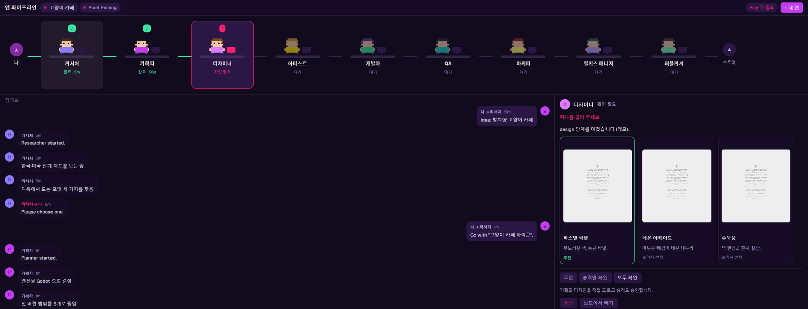
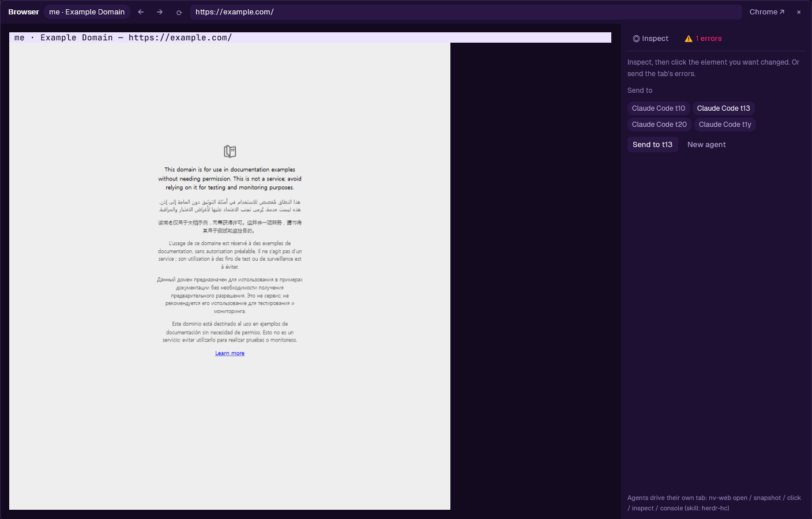

# herdr-toris-neon

[English](README.md) · [한국어](README.ko.md) · **简体中文** · [日本語](README.ja.md) · [Français](README.fr.md)

为 [Herdr](https://herdr.dev)(面向 AI 编程智能体的桌面应用和终端)准备的工作区扩展包。你可以在 Herdr 里看着一支智能体团队策划、开发、测试并发布应用:带像素风团队看板的应用流水线、智能体可以操作的真实浏览器、拉取请求、设备列表、用量,以及霓虹紫主题。



## 包含的内容

| 功能 | 打开方式 | 作用 |
| --- | --- | --- |
| **Auto app** | + 菜单 → Auto app · `Ctrl/Cmd+Shift+Y` | 给出文件夹和想法,智能体团队会完成调研、策划、设计、开发、真机测试、商店素材准备,并通过 fastlane 发布。 |
| **带 Inspect 的浏览器** | `Ctrl/Cmd+Shift+U` | Herdr 里的真实 Chrome/Edge。智能体操作各自的标签页;你点击元素、写下要改的内容,再发给智能体。 |
| **ALL agents** | `Ctrl/Cmd+Shift+A` | 在一个画面里查看所有运行中智能体的终端。再按一次返回。 |
| **拉取请求** | `Ctrl/Cmd+Shift+G` | 在终端旁边阅读、评论并合并仓库的 PR。 |
| **设备** | `Ctrl/Cmd+Shift+D` | 列出本机和已连接机器上的 adb 设备(USB、Wi-Fi)、Android 模拟器和 iOS 模拟器。 |
| **文件、编辑器、代码** | Files · `Ctrl/Cmd+Shift+H` | 文件树与编辑器、Markdown/HTML 预览、代码高亮。 |
| **AI 用量** | + 菜单 → AI用量 | 跨多台机器查看 Claude 和 Codex 的令牌、预估费用和额度。 |
| **粘贴截图** | `Ctrl+V` · `Cmd+V` | 剪贴板里的截图会作为图片进入 Claude Code 或 Codex,也能粘贴到另一台机器的终端。 |
| **更新** | + 菜单 → 更新 | 从 GitHub 下载最新版本并安装,并在屏幕上显示进度。 |
| **智能体技能** | 已为 Claude Code 和 Codex 安装 | `herdr-hc` 技能教智能体用 `hc` 编排、操作窗口和使用浏览器。 |
| **霓虹紫主题** |  | 应用和终端 herdr 的配色,以及配套的终端配色方案。 |

## Auto app:从想法到商店

- 在 + 菜单打开 **Auto app**,选择项目文件夹,写下要做什么;如果有参考(Play 商店链接、仓库、截图)也一并放入。
- 九位成员依次工作:调研员、策划、设计师、美术、开发、测试、市场、发布经理、发布者。每位都是新启动的智能体,读一份任务、写一份结果,所以对话不会越积越多。
- 各模型负责擅长的工作:Grok 调研,Codex 绘图,Claude 策划、开发和发布。缺失或失败的模型由 Claude 接替。
- 开始前先配置团队:为每个角色选择本机已安装的智能体 CLI、模型、同时工作的人数和评审者。未通过评审或图片自动检查的工作会再做一轮,失败的测试会退回给开发。
- 可以选择询问的程度:**无人值守**、**仅发布前确认**(默认)、**每次选择都确认**。创意和设计方案以卡片显示,点击即可选择。
- 应用用 Flutter 开发;游戏按类型使用 Godot 或 Unity + URP。发布先到 Play 内部测试轨道,再到正式版。
- 参考只用于学习,绝不照搬:借鉴类型和核心循环,名称、美术和文案全部重新制作。

详情:[应用流水线](docs/PIPELINE.md)。

## 浏览器:查看、指出、让它修好



- 在装有图形运行时的 macOS 和 Linux 上使用 herdr-web-browser;其他情况和 Windows 上,用独立的配置文件操作已安装的 Chrome 或 Edge。
- 智能体使用 `nv-web`:`open`、`snapshot`、`click`、`type`、`inspect`、`console --errors`、`network --failed`,以及先试一下样式修改的 `css`。
- **Inspect** 会把你点击的元素(选择器、样式、开发构建中的源文件、带标记的截图)发给你选择的智能体。

详情:[浏览器与文档预览](docs/BROWSER.md)。

## 智能体、拉取请求和设备


## 安装

需要 Herdr 桌面应用(或终端 herdr 0.9.5 及以上)、Node.js 22 及以上、Git。流水线使用你已安装的智能体 CLI(`claude`、`codex`、`grok`),发布使用 fastlane。拉取请求需要 GitHub CLI(`gh`)。

**macOS / Linux**

```bash
git clone https://github.com/torisKR/herdr-toris-neon.git
cd herdr-toris-neon
./install.sh
```

**Windows (PowerShell)**

```powershell
git clone https://github.com/torisKR/herdr-toris-neon.git
cd herdr-toris-neon
.\install.ps1
```

安装脚本会在修改前备份 herdr 配置和快捷键,然后安装主题、布局、模块和快捷键,不会替换你自己改过的快捷键。之后可以用 + 菜单的 **更新** 保持最新。

## 终端 herdr 插件

同一个包也能在终端 herdr 中使用:`prefix a` ALL agents,`prefix d` 设备,`prefix u` 文本浏览器,`prefix f` 文件和拉取请求(`prefix` 是 `ctrl+b`)。在远程面板里拖选文字会复制到你自己的剪贴板。

```bash
herdr plugin install torisKR/herdr-toris-neon/plugin
```

## 已验证的环境

- Windows 11 上的 Herdr 桌面应用:以上功能都在应用中运行过。流水线用替身智能体跑完了全程,第一阶段在 macOS 上用真实智能体运行过。
- macOS:运行了流水线第一阶段、粘贴截图(本机以及粘贴到 Windows 终端)和安装脚本的各个部分。流水线的后续阶段和商店上传尚未实际运行。

## 致谢

配色的灵感来自 VS Code 的 Cyber Purple 77 主题截图,并针对 herdr 的颜色标记重新挑选。macOS/Linux 上的图形浏览器是 [herdr-web-browser](https://github.com/MattJColes/herdr-web-browser)(MIT)。

## 许可证

MIT
